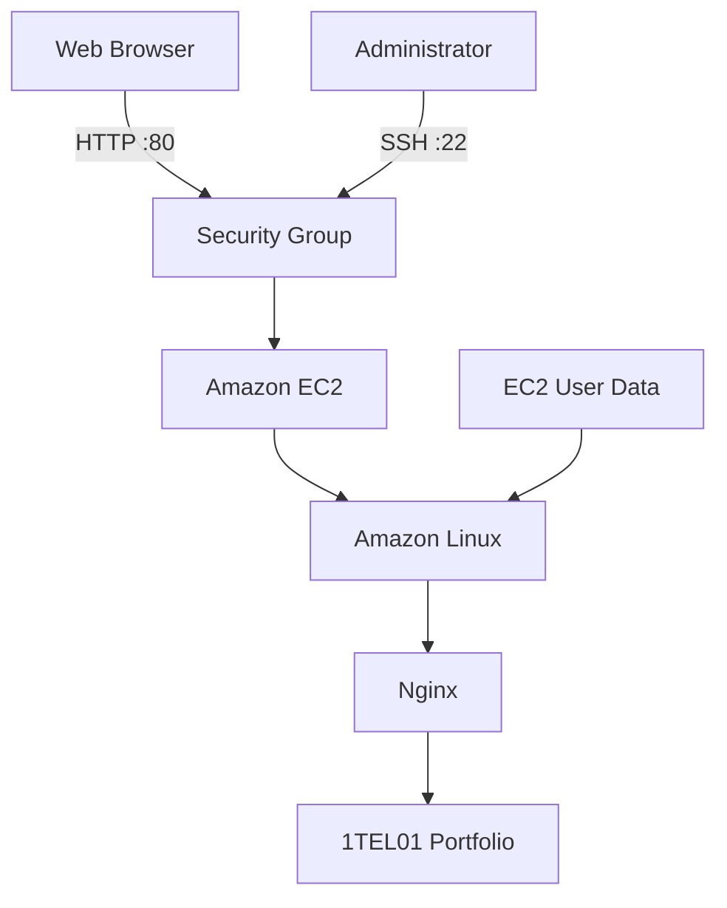

# AWS EC2: Deploying a Web Server on the Public Cloud

A hands-on cloud computing project focused on provisioning an Amazon EC2 instance, automating web server deployment with EC2 User Data, and publishing a website accessible through the public internet.

## Project Overview

This project demonstrates how to deploy a web server on AWS using Amazon Elastic Compute Cloud (EC2).

The deployment uses an Amazon Linux instance and a Bash script executed through EC2 User Data to automate the installation and configuration of Nginx. A Bootstrap-based website template is then published and accessed through the instance's public IPv4 address.

Remote administration is performed using SSH with PuTTY.

## Objectives

- Provision a virtual machine using Amazon EC2.
- Configure an Amazon Linux environment.
- Create and configure an EC2 key pair.
- Define network access rules using a security group.
- Automate Nginx installation using EC2 User Data.
- Establish a remote SSH connection using PuTTY.
- Verify the web server and access the website through a browser.
- Properly terminate cloud resources after deployment.

## Architecture



## Technologies Used

| Technology | Purpose |
|---|---|
| AWS EC2 | Cloud computing infrastructure |
| Amazon Linux | Instance operating system |
| Nginx | Web server |
| Bash | Deployment automation |
| EC2 User Data | Instance initialization |
| SSH | Secure remote administration |
| PuTTY | SSH client |
| Bootstrap | Website template |

## Deployment Process

### 1. Launch an EC2 Instance

Create a new EC2 instance with the following configuration:

| Parameter | Configuration |
|---|---|
| Instance name | Web Server |
| AMI | Amazon Linux |
| Architecture | 64-bit |
| Instance type | t3.micro |
| Key pair | RSA |
| Private key format | .ppk |

### 2. Configure Network Settings

Configure the security group with the following inbound rules:

| Type | Protocol | Port | Source |
|---|---|---|---|
| SSH | TCP | 22 | Administrator's IP |
| HTTP | TCP | 80 | 0.0.0.0/0 |

SSH access should be restricted to trusted IP addresses whenever possible.

### 3. Automate Deployment with User Data

EC2 User Data allows initialization commands to run when an instance is launched.

The Bash script used in this project automates the following tasks:

- Updates system packages.
- Installs Nginx, unzip, and wget.
- Starts and enables the Nginx service.
- Downloads and extracts the Bootstrap website template.
- Publishes the website in the Nginx document root.
- Changes the website title to `1TEL01 Portfolio`.
- Configures file permissions.
- Validates the Nginx configuration and restarts the service.

The deployment script is available in:

[`scripts/user-data.sh`](scripts/user-data.sh)

### 4. Connect to EC2 Using PuTTY

Configure PuTTY with:

| Parameter | Value |
|---|---|
| Host Name | EC2 Public IPv4 |
| Connection Type | SSH |
| Port | 22 |
| Authentication | Private key (.ppk) |
| Username | ec2-user |

Once connected, the administrator can execute commands on the remote instance.

### 5. Verify the Web Server

Check the Nginx service:

```bash
sudo systemctl status nginx
```

Verify the website files:

```bash
ls -la /usr/share/nginx/html/
```

The service should report:

```text
active (running)
```

### 6. Access the Website

Open a web browser and navigate to:

```text
http://<EC2-PUBLIC-IP>
```

The deployed website should display the Bootstrap template with the title:

**1TEL01 Portfolio**

### 7. Clean Up Resources

After completing the deployment:

1. Access the EC2 Instances console.
2. Select the created instance.
3. Choose Instance state.
4. Select Terminate instance.
5. Verify that the instance reaches the `Terminated` state.

## Expected Results

The successful deployment should demonstrate:

- An EC2 instance running Amazon Linux.
- A successful SSH connection through PuTTY.
- Nginx running as an active service.
- A website accessible through the public IPv4 address.
- Automated server initialization through EC2 User Data.

## Key Concepts Learned

- Infrastructure as a Service (IaaS).
- Virtual machines in public cloud environments.
- EC2 instance provisioning.
- Security groups and network access.
- SSH remote administration.
- Bash-based initialization.
- Web server deployment and verification.
- Public IPv4 addressing and DNS resolution.

## Repository Structure

```text
aws-ec2-web-server-deployment/
├── README.md
├── scripts/
│   └── user-data.sh
├── docs/
│   ├── architecture.md
│   └── troubleshooting.md
└── images/
    ├── ec2-instance.png
    ├── putty-connection.png
    ├── nginx-status.png
    └── web-page.png
```

## Disclaimer

This project was developed as a hands-on cloud computing laboratory.

AWS Academy environments may have specific resource restrictions and configurations. Instance types, availability, and console options may vary depending on the environment.

The website template is based on Start Bootstrap's Stylish Portfolio project.
